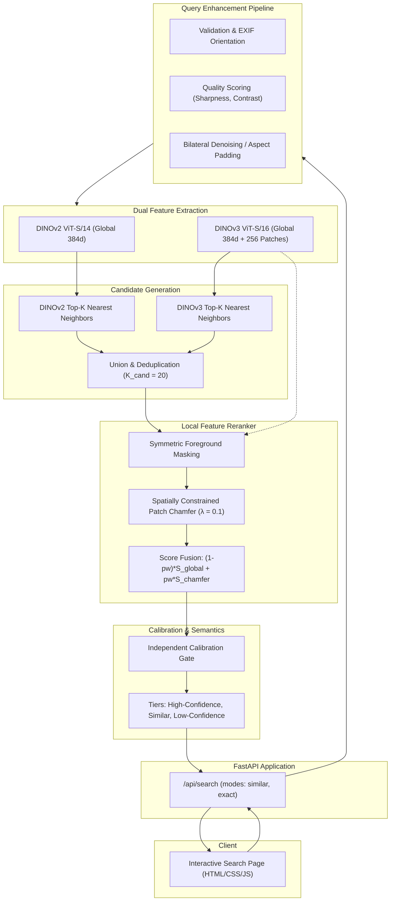

# System Architecture & Technical Specifications

## 1. Overview
The Jewellery Visual Retrieval Engine is a lightweight, local-first search system designed for fine jewellery items (rings, necklaces, pendants). It handles low-resolution catalog thumbnails (~262x262), high-detail stone arrangements, metal settings, and uncalibrated user image uploads.

## 2. Component Design

### A. Preprocessing Pipeline (`engine/preprocessing.py`)
- **EXIF Handling**: Transposes images to standard orientation based on EXIF tag 274.
- **Aspect-Ratio Preserving Resize & Padding**: Prevents distortion of circular ring shanks and gem silhouettes; embeds image with neutral padding.
- **Image Quality Scoring**: Computes Laplacian variance for sharpness, pixel histogram percentiles for under/overexposure, and foreground ratio.
- **Optional Denoising & Contrast Enhancement**: CLAHE (Contrast Limited Adaptive Histogram Equalization) on luminance, mild bilateral filter.

### B. Embedding Models (`engine/embeddings.py`, `engine/dinov3_encoder.py`)
- **DINOv2 (`vit_small_patch14_dinov2`)**: 384-dimensional dense self-supervised representation, capturing micro-structure, prongs, facets, and stone counts without text bias.
- **DINOv3 (`vit_small_patch16_dinov3.lvd1689m`)**: 384-dimensional global representation and $16 \times 16 = 256$ spatial patch tokens for fine-grained local correspondence.
- **OpenCLIP (`ViT-B-32`)**: 512-dimensional multimodal baseline.
- **L2 Normalization**: All vectors normalized so cosine similarity equals the dot product.

### C. Vector Index & Patch Cache (`engine/index.py`, `data/index/`)
- In-memory numpy matrices for global embeddings (`dinov2_embeddings.npy`, `dinov3_embeddings.npy`).
- Spatial patch cache (`data/index/dinov3_patches.npy`) holding $(432, 256, 384)$ float32 patch embeddings.
- Versioned patch metadata cache (`data/index/dinov3_patches.meta.json`, version 1.1.0) storing catalog image IDs, manifest SHA-256 hash, and precomputed foreground patch masks.

### D. Hybrid Search & Local Reranking (`engine/hybrid_search.py`, `engine/reranker.py`)
- **Candidate Generation**: Retrieves top-$K_{\text{cand}}$ candidates from DINOv2 and DINOv3 independently, forming a deduplicated union set ($K_{\text{cand}}=20$).
- **Score Normalization**: Evaluates dual-model average cosine similarity:
  $$S_{\text{global}} = \frac{1}{2}(\cos_{v2} + \cos_{v3})$$
  This replaces arbitrary query-relative RRF division with an absolute, calibrated similarity metric.
- **Symmetric Chamfer Reranker**:
  - Computes foreground masks for both query and candidate patch tokens using L2 feature norm thresholding (foreground patches have significantly larger activation norms than background padding).
  - Degenerate fallback: If either image contains $<4$ foreground patches, reranks using all tokens.
  - Spatial distance penalty:
    $$S_{ij} = \cos(p_{q,i}, p_{c,j}) - \lambda \cdot \|u_i - v_j\|_2$$
    Penalizes matching physically distant patches across the image grid ($\lambda = 0.1$).
  - Chamfer similarity:
    $$S_{\text{chamfer}} = \frac{1}{2 |I_q|} \sum_{i \in I_q} \max_{j \in I_c} S_{ij} + \frac{1}{2 |I_c|} \sum_{j \in I_c} \max_{i \in I_q} S_{ij}$$
- **Score Fusion**:
  $$\text{final\_score} = (1 - \text{patch\_weight}) \cdot S_{\text{global}} + \text{patch\_weight} \cdot S_{\text{chamfer}}$$
  Tested across $\text{patch\_weight} \in [0.0, 1.0]$. Default operational configuration: $\text{patch\_weight} = 0.2$ (or $0.5$ for maximum MRR).

### E. Confidence Calibration & Rejection Gate (`engine/search.py`, `scripts/calibrate_thresholds.py`)
- Independent thresholds per model configuration calibrated against 100 positive augmentations and 300 negative distractors.
- **Search Modes**:
  - `mode="similar"`: Returns top-$K$ candidates with confidence tier annotations.
  - `mode="exact"`: Rejects candidates with score $< \tau_{\text{exact}}$, setting `exact_match_found: false` if no candidate qualifies.
- **Candidate Semantics**: Strictly qualifies matches as "High-Confidence Candidate Match", "Visually Similar Candidate", or "Low Confidence Candidate".

### F. API Service & Web UI (`app/main.py`, `frontend/`)
- FastAPI application exposing `/api/search` with explicit parameters `model`, `mode`, `patch_weight`, `spatial_weight`, and `top_k`.
- Returns detailed 7-stage timing diagnostics: `t_decode_ms`, `t_prep_ms`, `t_encode_v2_ms`, `t_encode_v3_ms`, `t_candidate_ms`, `t_rerank_ms`, and `t_total_ms`.
- Interactive frontend displaying image previews, quality notices, confidence badges, candidate scores, and diagnostic latency breakdown.

### G. Component Localization & Region Retrieval (`engine/localization.py`, `engine/region_search.py`)
- **JewelleryLocalizer**: CPU-efficient (<2ms) morphological opening with an elliptical kernel strips thin chain lines (<5px) on necklaces, isolating the dense pendant blob. On rings, crown setting heuristics bound the top 45% of the contour, isolating the centre stone and setting from the plain shank metal.
- **Region-Aware Retrieval (`engine/region_search.py`)**: Indexes localized component embeddings for all catalog items (`dinov2_region_embeddings.npy`, `dinov3_region_embeddings.npy`). Provides Full, Region-only, Combined score fusion, and Region reranking modes with graceful fallback ($w_{reg}=0.0$) on degenerate crops.
- **Component Annotation Studio (`/region-annotate`, `frontend/region_annotate.html`)**: Interactive drag-and-draw bounding box tool with REST API endpoints (`/api/regions/list`, `/api/regions/save`, `/api/regions/propose`).
- **UI Bounding Box Overlay**: `/api/search` returns query component localization details, and the web UI renders the detected bounding box and confidence tag directly over the query preview.

### H. Soft Spatial Attention & Patch Token Reweighting (`engine/soft_attention.py`, `engine/attention_search.py`)
- **Train-Free Continuous Aggregation**:
  $$z = \text{normalize}\left(\frac{\sum_{i=1}^{256} w_i p_i}{\sum_{i=1}^{256} w_i + \epsilon}\right)$$
  Computes continuous spatial weights $w_i \in [\text{floor}, 1.0]$ over $16 \times 16$ patch grids, attenuating background pixels and secondary chains while retaining vital geometric context that hard-cropping destroys.
- **Continuous Weighting Modes**:
  1. *Uniform*: Standard spatial average pooling.
  2. *Multi-Cue Foreground Saliency*: Non-white mask, HSV saturation, and Sobel gradient magnitude.
  3. *Soft Component Region*: Exponential Euclidean distance decay from the detected pendant/crown bounding box with a 0.25 floor.
  4. *2D Anisotropic Gaussian*: Gaussian spatial prior fitted to component dimensions.
  5. *Combined Multi-Cue*: Pointwise product of foreground saliency and soft region decay.
- **Catalog Index Matrices**: Pre-aggregates all 432 catalog items across all 8 configurations into in-memory float32 matrices (`dinov2_soft_*.npy`, `dinov3_soft_*.npy`), enabling instant dot-product similarity lookup.
- **Visual Explainability & UI Heatmap**: Blends 2D Turbo colormap heatmaps over query photographs for transparent explainability without biological claims. Live toggle supported in UI.

