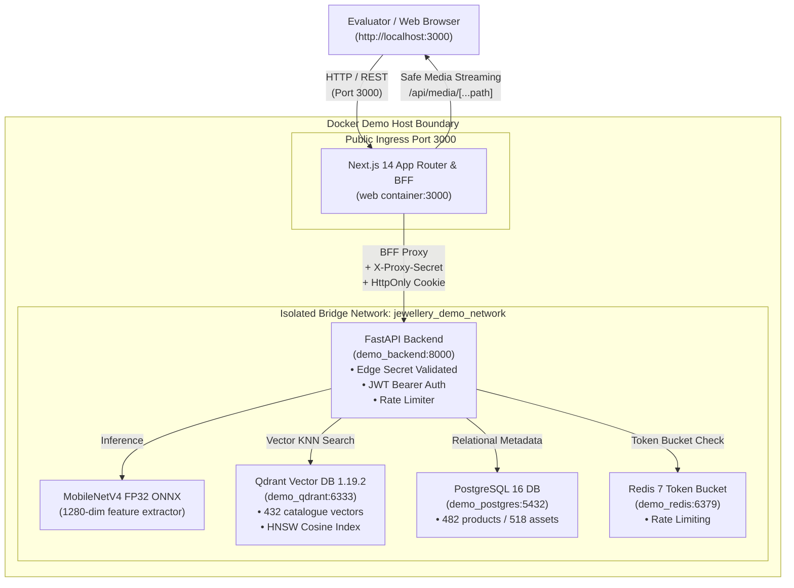

# Jewellery Visual Retrieval Engine — Interactive Demo Guide

**Interactive Web Application URL**: [http://localhost:3000](http://localhost:3000)  
**System Architecture**: Next.js 14 App Router (BFF Layer) + FastAPI + MobileNetV4 FP32 ONNX (1280-d) + Qdrant 1.19.2 + PostgreSQL 16 + Redis 7  
**Demo Compose File**: [`docker-compose.demo.yml`](./docker-compose.demo.yml)  
**Automated Verification Suite**: [`scripts/verify_demo_e2e.py`](./scripts/verify_demo_e2e.py)

---

## 💎 1. Overview & Objective

The **Jewellery Visual Retrieval Engine Demo** is a complete, production-grade web application packaged for local evaluation. It connects directly to live AI models and vector databases:

- **Real Visual Similarity Retrieval**: Zero mockups or hardcoded responses. Every query image is processed in real time through our MobileNetV4 Conv-Small FP32 ONNX model (1280 dimensions) and matched against the live Qdrant index (`jewellery_catalog_mobilenetv4_v1`).
- **Edge-Hardened Architecture (BFF)**: The Next.js frontend acts as a Backend-For-Frontend (BFF). All internal secrets (`X-Proxy-Secret`, database credentials, JWT keys) remain strictly server-side.
- **Network Boundary Security**: All internal datastores (PostgreSQL on port 5432, Redis on port 6379, Qdrant on port 6333, and the FastAPI backend on port 8000) are sealed inside the internal Docker bridge network (`jewellery_demo_network`). The only publicly exposed host port is `3000` (the Next.js web application).

---

## 🏗️ 2. System Architecture



---

## 🚀 3. Quickstart & Launch Instructions

### Prerequisites
- Docker Engine 24.0+ and Docker Compose v2.20+
- At least 4 GB available system RAM
- Free host port: `3000`

### Step 1: Clone and Enter Directory
```bash
cd /Users/amol/Developer/search
```

### Step 2: Launch the Stack via Docker Compose
Run the following command to build and launch all 5 containers in detached mode:
```bash
docker compose -f docker-compose.demo.yml --env-file .env.demo up -d --build
```

### Step 3: Run the Automated Stack Bootstrapper (If Initializing Clean Stack)
The repository includes an automated script that applies database migrations, seeds the relational product catalog (482 products), and creates the MobileNetV4 vector collection with blue-green alias bindings:
```bash
python scripts/init_demo_stack.py
```
*(Note: If launching on an existing workspace where this has run, the script is fully idempotent).*

### Step 4: Open in Your Browser
Navigate to **[http://localhost:3000](http://localhost:3000)** in Chrome, Firefox, or Safari.

---

## 🖥️ 4. Interactive Application Walkthrough

The demo web application features four dedicated views accessible via the top navigation bar:

### A. Visual Search Workspace (`/`)
The primary workspace for conducting visual similarity queries.
1. **Upload Query Image**:
   - Drag and drop any jewellery image (`.jpg`, `.jpeg`, `.png`, `.webp`) onto the dropzone or click to open the file selector.
2. **Instant Test Samples (No local images needed!)**:
   - Click any of the 4 pre-loaded sample thumbnails beneath the dropzone:
     - `Ring 032 (Studio Variant)`: High-confidence matching query.
     - `Ring 001 (Solitaire Classic)`: Classic solitaire diamond ring.
     - `Necklace 005 (Pendant Chain)`: Fine chain necklace with pendant.
     - `Ring 020 (Pavé Band)`: Intricate pavé ring setting.
3. **Search Parameters & Filters**:
   - **Search Mode**:
     - *Visual Style Exploration* (Threshold: $0.70$): Discovers stylistically related designs, matching prongs, and aesthetic variants.
     - *Exact Twin Retrieval* (Threshold: $0.94$): Strict precision mode calibrated to return verified twin pieces or exact catalogue duplicates.
   - **Category Filter**: Restrict results to `All Categories`, `Rings`, or `Necklaces`.
   - **Top-K Slider**: Choose between 4 and 24 results (default: 8).
   - **Image Enhancements**: Toggle *Bilateral Facet-Preserving Denoise* or *CLAHE Contrast Normalization*.
4. **Latency & Performance Breakdown**:
   - After executing a search, inspect the real-time latency card below the results:
     - **Client E2E Latency**: Full browser roundtrip time.
     - **Server Preprocessing**: EXIF orientation, geometry-preserving padding, and filtering.
     - **ONNX Model Inference**: MobileNetV4 Conv-Small FP32 forward pass.
     - **Qdrant Vector Retrieval**: HNSW cosine similarity search time.
5. **Interactive Results Grid**:
   - Ranked result cards displaying similarity percentage (e.g. `93.29% Similarity`).
   - Confidence badges (`Exact SKU Match`, `Probable Match`, `Stylistic Variant`).
   - **"Search with this item"**: Click the search icon on any result card to immediately re-run the visual search using that item as the new query!
6. **Side-by-Side Comparison Lightbox**:
   - Click any result card to open a high-resolution split comparison modal displaying the Query Image alongside the Retrieved Candidate, complete with vector distance and detailed metadata.

### B. Catalogue Explorer (`/catalogue`)
1. Browse through all **482 indexed catalogue items** in the relational PostgreSQL database.
2. Filter inventory by category (`ring`, `necklace`).
3. Search by SKU (e.g., `SKU-RING-VAR-001`, `SKU-NECKLACE-005`).
4. Click **"Search with this item"** on any inventory card to immediately test visual retrieval from the catalogue browser.

### C. Benchmarks & Release Audit (`/evaluation`)
1. View verified empirical retrieval benchmark results (EXP-001, EXP-002, and PH-010 through PH-013).
2. Compare DINOv2 vs OpenCLIP baseline vs MobileNetV4 ONNX.
3. Review the **Production Release Gate Status Table**, honestly tracking active release gates including our external blockers:
   - `Physical Ring Studio Acquisition`: **RELEASE BLOCKER** (50 verified SKUs under SOP-PH005 required).
   - `Distributed 1M+ Cloud Benchmark`: **RELEASE BLOCKER** (AWS `c6i.4xlarge` live provisioning required).
   - `Pre-Production Deployment Readiness`: **PASSED & OPERATIONAL**.

### D. System Health & Observability (`/status`)
1. Deep system health dashboard querying live container readiness probes:
   - PostgreSQL 16 Relational Database: Connected.
   - Redis 7 Token Bucket Limiter: Connected.
   - Qdrant 1.19.2 Vector Database: Connected (Point Count: 432).
   - MobileNetV4 ONNX Model: Loaded and active.
   - Active Vector Collection Alias: `jewellery_catalog_mobilenetv4_v1`.

---

## 🔐 5. Authentication & Access Modes

The demo application is configured for friction-free evaluation:

1. **Pre-Configured Demo Mode (Seamless)**:
   - By default, unauthenticated users can perform visual searches immediately. The BFF layer signs requests with the default demo tenant identity (`default_tenant`).
2. **Operator Login (Optional)**:
   - Click the **"Sign In"** button in the top navigation bar.
   - Click the **"Autofill Demo Credentials"** button to populate:
     - **Email**: `admin@jewellery.internal`
     - **Password**: `dev_password_2026`
   - Click **"Sign In"** to authenticate. The session is stored in a secure `HttpOnly` cookie.
   - The navigation bar updates to display `Admin Operator` status and your active session scopes (`tenant:admin`, `catalog:write`, `ops:admin`, `search:read`).

---

## 🧪 6. Automated Smoke Verification

To verify the entire Docker stack programmatically from your terminal, run the automated E2E smoke test:

```bash
python scripts/verify_demo_e2e.py
```

### Verification Stages Executed:
1. **Server Liveness**: Verifies HTTP 200 response on `http://localhost:3000`.
2. **Page Rendering**: Validates that `/`, `/catalogue`, `/evaluation`, and `/status` render without error.
3. **Deep System Status**: Verifies PostgreSQL, Redis, Qdrant, and ONNX readiness.
4. **Catalogue API**: Validates 482 relational products and image thumbnail paths.
5. **Authentication Flow**: Validates operator login and `HttpOnly` session verification.
6. **Live Visual Search**: Sends `q_ring_var_001_ring_032.jpg` to `/api/search`, asserts similarity $> 90\%$ to `ring_032.jpg`, checks latency metrics, and tests media streaming.
7. **Network Boundary Isolation**: Asserts that internal ports 5432 and 6379 are sealed from the public host network.

---

## 🛠️ 7. Troubleshooting & Common Questions

| Issue | Cause | Solution |
|---|---|---|
| **Port 3000 already in use** | Another process is bound to host port 3000. | Change the port mapping in `docker-compose.demo.yml`: `ports: ["3001:3000"]` and access at `http://localhost:3001`. |
| **Qdrant points show 0** | Index was not populated during stack start. | Run `python scripts/init_demo_stack.py` to index the 432 catalogue embeddings. |
| **Containers fail to start** | Docker daemon is running low on disk space or RAM. | Check `docker stats` and ensure at least 4 GB memory is allocated to Docker Desktop. |
| **Search returns 403 Forbidden** | Edge proxy secret mismatch. | Ensure `.env.demo` has matching `INTERNAL_PROXY_SECRET` and `EDGE_PROXY_SECRET` values. |
| **Images do not render** | Volume mount issue for media. | Ensure `data/` and `dataset/` directories exist and are mounted read-only in `docker-compose.demo.yml`. |

---

## 🛑 8. Stopping the Demo Stack

To safely stop and tear down the demo containers:
```bash
docker compose -f docker-compose.demo.yml --env-file .env.demo down
```
To also remove persistent volumes:
```bash
docker compose -f docker-compose.demo.yml --env-file .env.demo down -v
```
