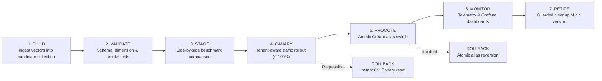

# Blue-Green Promotion, Canary Search Routing & Rollback Runbook

**Service**: Jewellery Visual Retrieval Engine  
**Release**: v0.2.0 (Milestone PH-009)  
**Target Environment**: Containerized FastAPI + Qdrant 1.19.2 + Prometheus / Grafana  

---

## 1. Lifecycle State Machine Overview

The index lifecycle manager enforces a strict, reversible seven-stage operational pipeline:



---

## 2. Pre-Requisites & Permissions

All operational lifecycle and canary management actions require the **`ops:admin`** RBAC scope.
Ordinary search consumers (`search:read`) are forbidden from accessing lifecycle APIs (`HTTP 403 Forbidden`).

Every lifecycle transition emits a permanent, immutable record in PostgreSQL table `audit_logs` containing the actor ID, timestamp, target collection, and operation parameters.

---

## 3. Step-by-Step Operator Procedures

### Step 1: Register Candidate Index
Once a new collection is built (e.g. `jewellery_catalog_mobilenetv4_v2`):
```bash
curl -X POST "http://localhost:8000/api/lifecycle/candidate/register" \
     -H "Authorization: Bearer $OPS_TOKEN" \
     -H "Content-Type: application/json" \
     -d '{"collection_name": "jewellery_catalog_mobilenetv4_v2"}'
```

### Step 2: Run Automated Integrity & Smoke Validation
Verify that the candidate collection has 1280-dimensional vectors, Cosine distance, point counts $>0$, and returns valid tenant-scoped search results without throwing errors:
```bash
curl -X POST "http://localhost:8000/api/lifecycle/candidate/validate" \
     -H "Authorization: Bearer $OPS_TOKEN" \
     -H "Content-Type: application/json" \
     -d '{"collection_name": "jewellery_catalog_mobilenetv4_v2", "min_points": 10}'
```

### Step 3: Execute Benchmark Parity Evaluation
Execute side-by-side benchmark comparison against active production on the standard 60-query benchmark set:
```bash
python scripts/evaluate_index_candidate.py \
    --candidate jewellery_catalog_mobilenetv4_v2 \
    --output output/ph009_candidate_evaluation.json
```
**Gate Criteria**:
- Candidate Recall@20 $\ge 90\%$.
- Search latency p95 $\le 60$ ms.
- Top-1 prediction agreement with production $\ge 90\%$.

### Step 4: Configure and Scale Canary Traffic
Start with an explicit allowlist or a low percentage:
```bash
# Phase 4.1: VIP Tenant Allowlist only
curl -X POST "http://localhost:8000/api/lifecycle/canary/config" \
     -H "Authorization: Bearer $OPS_TOKEN" \
     -H "Content-Type: application/json" \
     -d '{
       "enabled": true,
       "candidate_collection": "jewellery_catalog_mobilenetv4_v2",
       "percentage": 0,
       "allowlisted_tenants": ["tenant_luxury_corp"],
       "fallback_to_production": true
     }'

# Phase 4.2: Gradual Percentage Rollout (10% -> 25% -> 50%)
curl -X POST "http://localhost:8000/api/lifecycle/canary/config" \
     -H "Authorization: Bearer $OPS_TOKEN" \
     -H "Content-Type: application/json" \
     -d '{"enabled": true, "percentage": 25}'
```

> [!NOTE]
> Canary cohort assignment is **deterministic** per tenant ID via salted SHA-256 hash. Repeated requests from the same tenant always land on the same target index, preventing erratic user experiences.

### Step 5: Monitor Telemetry in Grafana
Open Grafana and inspect the **`Canary Comparison & Rollout`** dashboard:
1. Verify `Traffic Share (QPS)` matches the configured percentage.
2. Confirm `Search Latency p95` for canary is equal to or faster than production.
3. Verify `Canary Routing Fallbacks` is 0.

### Step 6: Atomic Production Promotion
Execute blue-green promotion. Qdrant atomically redirects the stable production alias (`jewellery_catalog_mobilenetv4`) to the candidate collection:
```bash
# Step 6.1: Dry Run Verification
curl -X POST "http://localhost:8000/api/lifecycle/promote" \
     -H "Authorization: Bearer $OPS_TOKEN" \
     -H "Content-Type: application/json" \
     -d '{"candidate_collection": "jewellery_catalog_mobilenetv4_v2", "dry_run": true}'

# Step 6.2: Execute Live Promotion
curl -X POST "http://localhost:8000/api/lifecycle/promote" \
     -H "Authorization: Bearer $OPS_TOKEN" \
     -H "Content-Type: application/json" \
     -d '{"candidate_collection": "jewellery_catalog_mobilenetv4_v2", "dry_run": false}'
```
Upon successful promotion:
- Canary routing is automatically disabled (`percentage=0`).
- The application cache re-binds search engines to the promoted alias.
- The previous production collection remains online and ready for immediate rollback.

### Step 7: Reversible Rollback (Disaster Recovery)
If an unexpected anomaly occurs post-promotion, revert production back to the previous collection in $<100$ ms:
```bash
curl -X POST "http://localhost:8000/api/lifecycle/rollback" \
     -H "Authorization: Bearer $OPS_TOKEN" \
     -H "Content-Type: application/json" \
     -d '{"dry_run": false}'
```

### Step 8: Guarded Collection Retirement
After the candidate has run stably in production through the rollback eligibility window (e.g. 7 days), clean up the obsolete collection:
```bash
curl -X POST "http://localhost:8000/api/lifecycle/retire" \
     -H "Authorization: Bearer $OPS_TOKEN" \
     -H "Content-Type: application/json" \
     -d '{"collection_name": "jewellery_catalog_mobilenetv4_old", "force": false}'
```
> [!CAUTION]
> The lifecycle manager strictly prevents retiring any collection currently mapped to the production alias or currently designated as the active rollback target. Attempting to do so returns `HTTP 403 Forbidden`.

---

## 4. Operational Failure Scenarios & Self-Healing

| Failure Event | System Reaction | Operator Action |
|---|---|---|
| **Candidate Collection Crash / Offline during Canary** | Router intercepts exception, increments `jewellery_canary_routing_fallbacks_total{reason="candidate_error"}`, and transparently serves query from production index. | Inspect candidate collection logs. Reset canary percentage to 0% via `/api/lifecycle/canary/config`. |
| **Promotion Interruption / Qdrant Timeout** | Atomic alias operations in Qdrant are transactional: if the request times out or fails, the existing alias remains completely untouched. | Verify alias status via `GET /api/lifecycle/status`. Retry promotion when Qdrant connectivity stabilizes. |
| **Tenant Spoofing Attempt during Canary** | Security middleware verifies authenticated identity before canary hashing. Foreign tenant parameters in form data trigger `HTTP 403 Forbidden`. | Audit security logs in PostgreSQL for anomalous actor attempts. |
