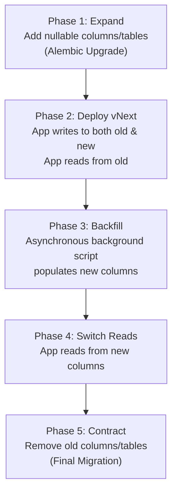

# Database Migration Safety & Release Runbook

**Service**: Jewellery Visual Retrieval Engine  
**Milestone**: PH-008 Deployment Reliability  
**Tooling**: Alembic 1.20.0 + SQLAlchemy 2.1.4 + PostgreSQL 16  

---

## 1. Overview & Architectural Principles

The Jewellery Visual Retrieval Engine relies on a dual-persistence architecture:
1. **Relational Database (PostgreSQL 16)**: Authoritative state for tenants, users, API keys, product SKUs, assets, ingestion job states, and security audit logs.
2. **Vector Database (Qdrant 1.19.2)**: High-dimensional vector points, HNSW graph structures, and searchable payload attributes.

Because relational records map 1:1 or 1:N to vector point IDs, schema changes require synchronized verification to prevent state divergence or search failures.

---

## 2. Pre-Deployment Safety Protocol (Mandatory Checklist)

Before executing any database migration in production:

- [ ] **1. Relational Backup**:
  Generate an immediate, verified PostgreSQL logical dump:
  ```bash
  pg_dump -U jewellery_user -h postgres -d jewellery_catalog -F c -b -v -f /backups/postgres_pre_migration_$(date +%Y%m%d_%H%M%S).dump
  ```
- [ ] **2. Vector Collection Snapshot**:
  Generate an immutable point-in-time snapshot of the active Qdrant vector collection:
  ```bash
  curl -X POST "http://qdrant:6333/collections/jewellery_catalog_mobilenetv4_v1/snapshots"
  ```
- [ ] **3. Inspect Dry-Run DDL**:
  Generate and inspect the raw SQL statements generated by Alembic without executing them:
  ```bash
  alembic upgrade --sql head
  ```
  Verify that no unexpected `DROP TABLE`, `DROP COLUMN`, or long-running table locks (`ALTER TABLE ... DEFAULT`) exist.
- [ ] **4. Verify Connection Pool Capacity**:
  Confirm that active client connections are low and no long-running ingestion transactions are active:
  ```sql
  SELECT pid, query_start, state, query 
  FROM pg_stat_activity 
  WHERE datname = 'jewellery_catalog' AND state != 'idle';
  ```

---

## 3. Migration Execution Procedure

Migrations must be run as an explicit, controlled initialization step before traffic is routed to newly deployed application containers.

### Step 3.1: Running the Migration via CLI
```bash
# Execute within the application container or migration runner
alembic upgrade head
```

### Step 3.2: Verifying Current Revision
Verify that the database catalog reflects the intended migration revision head:
```bash
alembic current
# Expected output:
# 2b2680c6fd51 (head)
```

### Step 3.3: Verifying Application Readiness
Execute a readiness probe against the application backend:
```bash
curl -s http://localhost:8000/health/ready | jq .
```
Ensure that `dependencies.database.status == "connected"` and the HTTP response status code is `200 OK`.

---

## 4. Rollback Policy & Inherent Limitations

### 4.1. Rollback Procedure
If an issue is detected immediately post-migration:
```bash
alembic downgrade -1
```

### 4.2. Explicit Rollback Limitations & Hazards
> [!WARNING]
> Schema rollbacks cannot automatically restore deleted or transformed data. 

1. **Destructive Column Removal**: If a migration drops a column or converts types, running `alembic downgrade` recreates the column structure but **does not restore previous column values**.
2. **Dual-Store Divergence**: If an application starts ingesting vectors into Qdrant under a new schema, rolling back PostgreSQL leaves orphaned vector points in Qdrant with broken foreign-key relationships.
3. **Disaster Recovery via Snapshots**: If schema corruption or state divergence occurs, **do not attempt cascading manual SQL fixes**. Execute a coordinated restore of both the PostgreSQL `.dump` file and the corresponding Qdrant snapshot timestamped together.

---

## 5. Safe Zero-Downtime Migration Pattern (Expand-and-Contract)

For enterprise zero-downtime releases, always execute multi-phase expand-and-contract migrations:



1. **Never perform destructive changes** (`DROP COLUMN`, renaming columns, changing constraints) in the same release as code deployment.
2. **All newly added columns must be nullable** or have a non-locking default.
3. **Foreign key indexes** must be verified to prevent full table scans during cascade checks.
