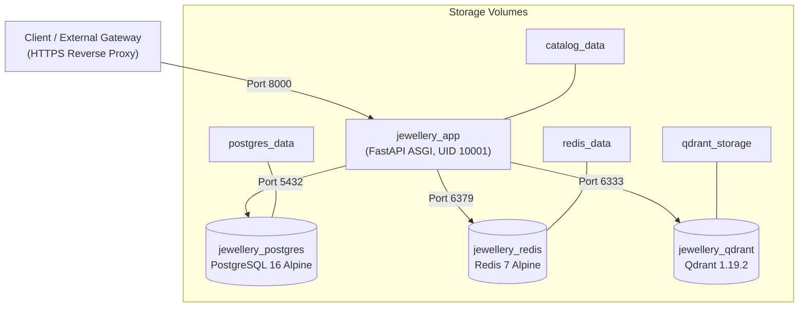

# Production Operator Runbook

**Service**: Jewellery Visual Retrieval Engine  
**Release**: v0.2.0 (Milestone PH-008)  
**Target Environment**: Linux x86_64 / arm64 Container Orchestration  

---

## 1. System Architecture & Component Inventory



### Component Details
| Service Name | Container Name | Base Image | Internal Port | Persistent Volume | Purpose |
|---|---|---|:---:|---|---|
| `app` | `jewellery_app` | `jewellery-retrieval-app:0.2.0` | `8000` | `catalog_data` | Visual search inference, auth, catalog APIs |
| `postgres` | `jewellery_postgres` | `postgres:16-alpine` | `5432` | `postgres_data` | Relational catalog, tenants, users, API keys, audit logs |
| `redis` | `jewellery_redis` | `redis:7-alpine` | `6379` | `redis_data` | Atomic Lua token-bucket rate limiter, cache |
| `qdrant` | `jewellery_qdrant` | `qdrant/qdrant:v1.19.2` | `6333` | `qdrant_storage` | High-dimensional HNSW vector index (1280-dim MobileNetV4) |

---

## 2. High-Availability (HA) Scope Disclaimer & Single-Host Boundaries

> [!IMPORTANT]
> **Single-Host Limitation Notice**:  
> The provided `docker-compose.prod.yml` manifests a single-host topology intended for dedicated edge instances, pilot deployments, or staging environments.  
> **This does NOT constitute High Availability (HA) or Fault Tolerance (FT)**:
> 1. A physical host reboot or hypervisor failure halts all four services simultaneously.
> 2. Local disk corruption or exhaustion impacts both relational and vector persistence volumes.
> 3. Production multi-region or enterprise HA SLAs require:
>    - Managed Multi-AZ PostgreSQL (e.g., AWS RDS / GCP Cloud SQL).
>    - Distributed Redis Cluster (e.g., AWS ElastiCache / Redis Enterprise).
>    - Multi-node Qdrant Cluster deployed across availability zones with Raft consensus.
>    - Autoscaled application containers behind an Application Load Balancer.

---

## 3. Deployment & Lifecycle Management

### 3.1. Initial Environment Setup
1. Copy the production environment template:
   ```bash
   cp .env.production.example .env.production
   ```
2. Generate a secure 64-character JWT secret key:
   ```bash
   openssl rand -hex 32
   ```
   Paste this into `JWT_SECRET_KEY` in `.env.production`.
3. Set strong credentials for `POSTGRES_PASSWORD`.

### 3.2. Starting the Service Stack
```bash
docker compose -f docker-compose.prod.yml --env-file .env.production up -d --build
```

### 3.3. Verifying Container Status
```bash
docker compose -f docker-compose.prod.yml ps
```
All containers (`jewellery_postgres`, `jewellery_redis`, `jewellery_qdrant`, `jewellery_app`) should report `Up (healthy)`.

### 3.4. Graceful Shutdown
To stop the services while honoring inflight requests (bounded by Uvicorn's `--timeout-graceful-shutdown 15`):
```bash
docker compose -f docker-compose.prod.yml down
```

---

## 4. Health Probes & Deep Diagnostics

### 4.1. Liveness Probe (`GET /health/live`)
- **Usage**: Used by Docker/Kubernetes container health monitors.
- **Contract**: HTTP 200 returned immediately as long as the Python process event loop responds.
```bash
curl -i http://localhost:8000/health/live
```

### 4.2. Readiness Probe (`GET /health/ready`)
- **Usage**: Used by load balancers and deployment gates before routing user traffic.
- **Contract**:
  - `HTTP 200 OK` (Status: `ready`): All systems (PostgreSQL, Redis, Qdrant, Model file) operational.
  - `HTTP 200 OK` (Status: `degraded`): PostgreSQL, Qdrant, and Model operational; Redis unreachable (fail-secure in-process limiter active).
  - `HTTP 503 Service Unavailable` (Status: `unavailable`): PostgreSQL, Qdrant, or Model weights missing/unreachable.
```bash
curl -i http://localhost:8000/health/ready
```

### 4.3. Prometheus Metrics (`GET /metrics`)
Scraped by Prometheus on standard 15-second intervals:
```bash
curl -s http://localhost:8000/metrics | grep jewellery_
```
Key metrics monitored:
- `jewellery_api_requests_total`: Request volume partitioned by endpoint and status code.
- `jewellery_stage_latency_seconds`: Histogram of inference pipeline stages (`preprocessing`, `encoding`, `search`, `overall`).
- `jewellery_qdrant_operations_total`: Vector DB query success/failure rates.
- `jewellery_ratelimit_events_total`: Rate limiter allow vs limit actions.

---

## 5. Rate Limiting Fail-Secure Operations

### 5.1. Normal Mode (Redis Online)
- Token bucket logic runs via atomic Lua script on Redis.
- Rate limits are distributed and synchronized across all application workers.

### 5.2. Outage Mode (Redis Down or Partitioned)
- If Redis fails to respond within 500ms, the limiter automatically falls back to an **in-process `InMemoryTokenBucket`**.
- **Security Policy**: Rather than failing open (which would permit DoS attacks during Redis outages), the system enforces **half the standard burst budget** in-process.
- **Operational Caveat**: In-process buckets are memory-local to each Python worker process. They do NOT synchronize tokens between separate workers or horizontal container replicas. Restore Redis immediately to resume synchronized global rate limiting.

---

## 6. Backup & Disaster Recovery Procedures

### 6.1. Relational Database Backup
```bash
docker exec -t jewellery_postgres pg_dump -U jewellery_user -d jewellery_catalog -F c -b -v -f /var/lib/postgresql/data/backup_$(date +%Y%m%d_%H%M%S).dump
```

### 6.2. Vector Collection Snapshot
```bash
curl -X POST "http://localhost:6333/collections/jewellery_catalog_mobilenetv4_v1/snapshots"
```

### 6.3. Coordinated Restoration
1. Stop the application container to prevent incoming writes:
   ```bash
   docker stop jewellery_app
   ```
2. Restore PostgreSQL:
   ```bash
   docker exec -i jewellery_postgres pg_restore -U jewellery_user -d jewellery_catalog --clean /var/lib/postgresql/data/backup_TARGET.dump
   ```
3. Restore Qdrant snapshot via REST API:
   ```bash
   curl -X POST "http://localhost:6333/collections/jewellery_catalog_mobilenetv4_v1/snapshots/upload?priority=snapshot" \
        -H "Content-Type: multipart/form-data" \
        -F "snapshot=@/path/to/snapshot.snapshot"
   ```
4. Restart application container:
   ```bash
   docker start jewellery_app
   ```
5. Confirm health:
   ```bash
   curl -s http://localhost:8000/health/ready | jq .
   ```
